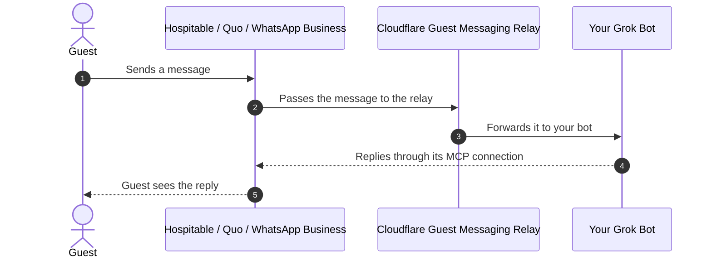

# Guest Messaging Relay

Lets your Grok Bot see guest messages from **Hospitable**, **Quo**, and **WhatsApp Business**, so it can help guests while you're away.



The relay runs free on Cloudflare, needs no coding, and takes about 10 minutes to set up in your web browser.

> **Want help?** Paste this into any AI assistant and it will walk you through it:
> *Help me set up the guest messaging relay from https://github.com/deepumukundan/guest-messaging-relay. Follow AGENTS.md in that repository.*

## Before you start

You'll need:

- A **paid Grok Bot plan**. This is the only paid part; everything else is free.
- A free [Cloudflare account](https://dash.cloudflare.com/sign-up)
- A free [GitHub account](https://github.com/signup)
- Your Grok Bot routine's **webhook URL** and **key** (see below)
- A password manager

<details>
<summary><strong>Where do I find my Grok Bot webhook URL and key?</strong></summary>

You can do this in the Grok Bot app on your computer or phone.

1. Open your bot, for example *Alfred · Guest Butler*.
2. On the **Details** tab, under **Routines**, open the routine that answers guests. Below its name it should say **When a webhook fires**.
3. Scroll all the way down to the **Webhook** section. It has three rows, each with a copy button:
   - **POST to**: your **webhook URL**. It starts with `https://`.
   - **key**: your **key**
   - **header**: not needed, because the relay adds it for you

No routine that says **When a webhook fires**? Create a routine, choose **When a webhook fires** as its trigger, and tell it what to do with guest messages.

</details>

## Step 1: Deploy the relay

[](https://deploy.workers.cloudflare.com/?url=https://github.com/deepumukundan/guest-messaging-relay)

1. Click the **Deploy to Cloudflare** button above and log in.
2. If you're asked to connect GitHub, allow it. If you're asked to pick a `workers.dev` subdomain, pick any name.
3. **Project name:** keep `guest-messaging-relay`. If it says *a repository with that name already exists*, add something to the end, like `guest-messaging-relay-2`. This name is also what your relay is called in Cloudflare.
4. Optional: tick **Create private Git repository** to keep your copy private.
5. Keep the suggested KV namespace and Queue names.
6. Fill in the three boxes:

   | Box | What to enter |
   | --- | --- |
   | `RELAY_PATH_TOKEN` | Your new **relay password**. Have your password manager make one with 40 letters and numbers (no symbols), and save it there. |
   | `RESPONDER_WEBHOOK_URL` | Your Grok Bot **webhook URL** (the **POST to** row) |
   | `RESPONDER_AUTH_HEADER` | Your Grok Bot **key** (the **key** row) |

7. Click **Deploy** and wait a minute or two.

## Step 2: Open your setup page

When the deploy finishes, open your relay's address. It looks like `https://guest-messaging-relay.your-name.workers.dev`, with your project name at the start. To find it again later, open [Workers & Pages](https://dash.cloudflare.com/?to=/:account/workers-and-pages) in Cloudflare, click your relay (its project name), and use the address ending in `workers.dev`.

Bookmark the page, type your relay password, and click **Check**. A green message means everything works. The page then shows your webhook links with **Copy** buttons, so you never have to type them.

## Step 3: Connect Hospitable

1. On your setup page, click **Copy link** under **Hospitable**.
2. In Hospitable, go to **Apps → Tools → Webhooks** and add a new webhook.
3. Name it *Guest Messaging Relay* and paste the link as the URL.
4. Select **Messages**, **Reservations**, and **Reviews**, then click **Save**.
5. Click **Test**. Your Grok Bot should receive a message within a few seconds.

That's it. Your bot now sees new guest messages from Hospitable.

<details>
<summary><strong>Also using Quo?</strong></summary>

1. On your setup page, copy the link under **Quo**.
2. In Quo, create a webhook for **message received** on each number, using that link.
3. Copy the webhook's **signing secret**, and add it in Cloudflare as a secret named `QUO_WEBHOOK_SECRET`. See [adding a secret](#adding-a-secret) below.
4. Check your setup page again. Quo should say **Ready**.

</details>

<details>
<summary><strong>Also using WhatsApp Business?</strong></summary>

This needs a **WhatsApp Business** number connected to a **Meta app** (Meta's WhatsApp Cloud API). The regular WhatsApp app, and the WhatsApp Business app on its own, can't send messages to the relay.

Do these in order, because Meta checks the link right away.

1. Make up a phrase, and add it in Cloudflare as a secret named `WHATSAPP_VERIFY_TOKEN`. See [adding a secret](#adding-a-secret) below.
2. Add your Meta app's secret as a secret named `WHATSAPP_APP_SECRET`. It's in your Meta app under **App settings → Basic → App secret**.
3. Check your setup page again. WhatsApp should say **Ready**. Copy its link.
4. In your Meta app, open **WhatsApp → Configuration**. Paste the link as the callback URL, enter the same phrase as the verify token, and subscribe to **messages**.

</details>

### Adding a secret

1. Open [Workers & Pages](https://dash.cloudflare.com/?to=/:account/workers-and-pages) in Cloudflare and click your relay (its project name).
2. Go to **Settings → Variables and Secrets** and click **Add**.
3. Choose type **Secret**, enter the name and value, and click **Deploy**.

## Security

### Already on (nothing to do)

- **Secret links.** Every webhook link contains your relay password. A request with the wrong link gets *not found* before anything else runs.
- **Hospitable** links accept only Hospitable's servers (their published address range, `38.80.170.0/24`).
- **Quo** requests must carry Quo's signature, made with your signing secret, and be less than 5 minutes old.
- **WhatsApp** requests must carry Meta's signature, made with your Meta app secret.
- **Limits.** Requests over 1 MB are refused, and a repeated message is forwarded only once.
- **Cloudflare DDoS protection** is automatic on every Cloudflare plan, including the free `workers.dev` address.
- **No secrets in logs.** The relay password is part of every link, so Cloudflare's automatic request logs and traces are turned off. Only the relay's own status lines are kept.

Your setup page shows Hospitable's protection level under the Hospitable link.

### Recommended

1. **Add Hospitable's signing secret.** If your Hospitable webhook shows a signing secret, add it in Cloudflare as a secret named `HOSPITABLE_WEBHOOK_SECRET` (see [adding a secret](#adding-a-secret)). Then click **Test** on the webhook in Hospitable. If the bot doesn't get the test and **Logs** shows `rejected_signature`, delete that secret and the relay goes back to the IP check alone.
2. **Stay on the Workers Free plan.** On Free, a flood of junk requests can't cost you money. The worst case is that the relay stops for the rest of the day (until 00:00 UTC) once the daily request limit is used up. On the Paid plan, every request is billed.
3. **Leave Cloudflare's "I'm Under Attack" mode and Bot Fight Mode off** for the relay's address. Hospitable, Quo, and Meta are servers, not browsers, so they can't pass those challenges and your messages would stop arriving.

<details>
<summary><strong>Optional: block junk traffic before it reaches the relay (needs your own domain)</strong></summary>

The `workers.dev` address can't have firewall rules. If you have a domain on Cloudflare (the free plan is enough), Cloudflare's firewall can block junk requests at the edge, so they never use up the relay's daily requests. Do these in order, so no messages are lost while you switch.

1. **Add a relay address on your domain.** In your relay's GitHub repository, open `wrangler.jsonc`, click the pencil icon, and add this line below `"workers_dev": true,`, using your own domain:

   ```jsonc
   "routes": [{ "pattern": "relay.yourdomain.com", "custom_domain": true }],
   ```

   Click **Commit changes**. Cloudflare redeploys the relay in a minute or two.
2. **Move your channels to the new address.** Open `https://relay.yourdomain.com`, check your password, and copy each link into Hospitable, Quo, and your Meta app in place of the old one. Test each channel.
3. **Add firewall rules.** In Cloudflare, open your domain, then **Security → WAF → Custom rules**, and create these. For each, click **Edit expression**, paste the expression, choose **Block**, and **Deploy**.

   | Rule name | Expression |
   | --- | --- |
   | Relay: only relay paths | `(http.host eq "relay.yourdomain.com" and not (http.request.uri.path eq "/" or starts_with(http.request.uri.path, "/hook/")))` |
   | Relay: only GET and POST | `(http.host eq "relay.yourdomain.com" and not http.request.method in {"GET" "HEAD" "POST"})` |
   | Relay: Hospitable only from Hospitable | `(http.host eq "relay.yourdomain.com" and ends_with(http.request.uri.path, "/hospitable") and not ip.src in {38.80.170.0/24})` |

4. **Add a rate limit.** Under **Security → WAF → Rate limiting rules**, create a rule for requests where **Hostname** equals `relay.yourdomain.com` and **URI Path** starts with `/hook/`, counted by **IP**, at more than **50 requests per 10 seconds**, with action **Block** for the shortest time offered. If your plan offers fewer choices, pick the closest ones.
5. **Turn off the old address.** Once every channel works on the new address, edit `wrangler.jsonc` again, change `"workers_dev": true` to `"workers_dev": false`, and commit. The `workers.dev` address then stops answering, so nobody can go around your firewall rules. Your setup page is now at `https://relay.yourdomain.com`.

</details>

## Something not working?

<details>
<summary><strong>The setup page says something is wrong</strong></summary>

| Message | What to do |
| --- | --- |
| *That password doesn't match* | Copy the relay password from your password manager again, with no spaces. |
| *The relay's settings aren't complete* | In Cloudflare, check the three values from Step 1 under **Settings → Variables and Secrets**. The relay password must be at least 32 letters and numbers with no symbols, and the webhook URL must start with `https://`. |

</details>

<details>
<summary><strong>My bot didn't get a message</strong></summary>

In Cloudflare, open your relay, then **Logs**, and look at the `outcome` of the latest entry:

| Outcome | Meaning |
| --- | --- |
| `forwarded` | Delivered. Check your Grok Bot routine. |
| `forward_failed` | Your bot didn't accept it. Check the Grok Bot URL and key. The relay keeps retrying for about 15 hours. |
| `rejected_signature` | A Quo, WhatsApp, or Hospitable secret doesn't match. Add it again. |
| `rejected_ip` | A request on the Hospitable link didn't come from Hospitable. Expected for junk traffic. |
| `dormant` | That channel's secret isn't set yet. |
| `rejected_path` | The webhook link is wrong. Copy it again from your setup page. |
| `dropped_non_guest` | The message was from you or an automation, not a guest. That's expected. |

</details>

<details>
<summary><strong>Good to know</strong></summary>

- **Bot down?** Messages wait and are retried for about 15 hours.
- **Free plan.** It handles about 1,000 messages and booking updates a day, which is plenty for a handful of homes.
- **Photos and voice notes.** These reach your bot from WhatsApp without their content.
- **Privacy.** Message text, guest names, and phone numbers are never written to the logs.
- **Password leaked?** Change `RELAY_PATH_TOKEN` (see [adding a secret](#adding-a-secret)), then copy the new links from your setup page into each channel.
- **Updates.** Your copy doesn't change when this repository does. To pick up improvements, ask an AI assistant to bring them into your copy on GitHub.

</details>

Developers: see [docs/TECHNICAL.md](docs/TECHNICAL.md) for how it works and how to deploy from your own computer.
