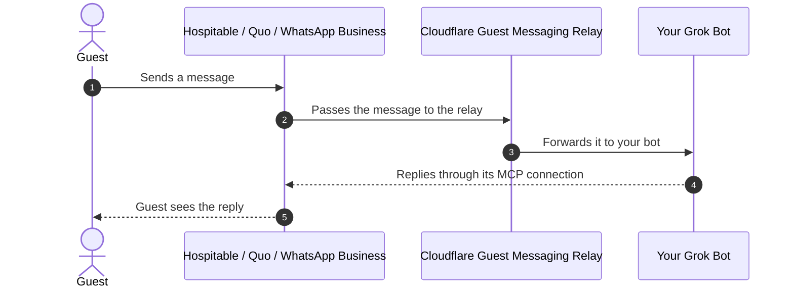

# Guest Messaging Relay

Lets your Grok Bot see guest messages from **Hospitable**, **Quo**, and **WhatsApp Business**, so it can help guests while you're away.

The relay runs free on Cloudflare, needs no coding, and takes about 10 minutes to set up in your web browser.

> **Want help?** Paste this into any AI assistant and it will walk you through it:
> *Help me set up the guest messaging relay from https://github.com/deepumukundan/guest-messaging-relay. Follow AGENTS.md in that repository.*

## Index

| # | Section | What it covers |
|---|---------|----------------|
| 0 | [Before you start](#before-you-start) | What you need ready |
| 1 | [Deploy the relay](#step-1-deploy-the-relay) | One-click deploy to Cloudflare |
| 2 | [Open your setup page](#step-2-open-your-setup-page) | Check the relay and copy your webhook links |
| 3 | [Connect Hospitable](#step-3-connect-hospitable) | Connect Hospitable, plus optional Quo and WhatsApp; [adding a secret](#adding-a-secret) |
| 4 | [Decide how your bot replies](#step-4-decide-how-your-bot-replies) | Approval mode or automatic replies |
| 5 | [Security](#security) | Recommended protection |
| 6 | [Something not working?](#something-not-working) | Troubleshooting table |
| 7 | [License](#license) | Terms of use |

## Before you start

You'll need:

- A **paid Grok Bot plan**. This is the only paid part; everything else is free. (WhatsApp has a free monthly limit; see its section below.)
- A free [Cloudflare account](https://dash.cloudflare.com/sign-up)
- A free [GitHub account](https://github.com/signup)
- Your Grok Bot routine's **webhook URL** and **key** (see below)
- A password manager

<strong>Where do I find my Grok Bot webhook URL and key?</strong>

You can do this in the Grok Bot app on your computer or phone.

1. Open your bot, for example *Alfred · Guest Butler*.
2. On the **Details** tab, under **Routines**, open the routine that answers guests. Below its name it should say **When a webhook fires**.
3. Scroll all the way down to the **Webhook** section. It has three rows, each with a copy button:
   - **POST to**: your **webhook URL**. It starts with `https://`.
   - **key**: your **key**
   - **header**: not needed, because the relay adds it for you

No routine that says **When a webhook fires**? See the next section.

<strong>Don't have a webhook routine yet?</strong>

The easiest way is to ask your bot to make one. Open a chat with your bot and send something like:

> *Create a new routine that runs when a webhook fires. It will receive incoming guest messages from Hospitable, Quo, and WhatsApp, sent by my guest messaging relay. Each message is JSON with a `source` field (`hospitable`, `quo`, or `whatsapp`), the guest's message in `body`, and the sender in `sender`. Hospitable also sends reservation and review updates. Read each message, work out which guest and home it's about, and reply to the guest through the same service using your connections.*

Change the wording to suit how you want guests answered. When the bot has made the routine, open it under **Details → Routines** and check that it says **When a webhook fires**. Its **Webhook** section then has the URL and key you need.

You can also make it yourself: create a routine, choose **When a webhook fires** as its trigger, and write the instructions.

**Replies.** The relay only brings guest messages *to* your bot. To answer, your bot needs its own MCP connection to each service you use. Whether it asks your approval first or replies on its own is set in the routine; see [Step 4](#step-4-decide-how-your-bot-replies).

## Step 1: Deploy the relay

1. Click the **Deploy to Cloudflare** button above and log in.
2. If you're asked to connect GitHub, allow it. If you're asked to pick a `workers.dev` subdomain, pick any name.
3. **Project name:** keep `guest-messaging-relay`. If it says *a repository with that name already exists*, add something to the end, like `guest-messaging-relay-2`. This name is also what your relay is called in Cloudflare.
4. Optional: tick **Create private Git repository** to keep your copy private.
5. Keep the suggested KV namespace and Queue names.
6. Fill in the three boxes:

   | Box | What to enter |
   | --- | --- |
   | `RELAY_PATH_TOKEN` | Your new **relay password**. Have your password manager make one with 40 letters and numbers (no symbols), and save it there. |
   | `RESPONDER_WEBHOOK_URL` | Your Grok Bot **webhook URL** (the **POST to** row) |
   | `RESPONDER_AUTH_HEADER` | Your Grok Bot **key** (the **key** row) |

7. Click **Deploy** and wait a minute or two.

## Step 2: Open your setup page

When the deploy finishes, open your relay's address. It looks like `https://guest-messaging-relay.your-name.workers.dev`, with your project name at the start. To find it again later, open [Workers & Pages](https://dash.cloudflare.com/?to=/:account/workers-and-pages) in Cloudflare, click your relay (its project name), and use the address ending in `workers.dev`.

Bookmark the page, type your relay password, and click **Check**. A green message means everything works. The page then shows your webhook links with **Copy** buttons, so you never have to type them.

## Step 3: Connect Hospitable

1. On your setup page, click **Copy link** under **Hospitable**.
2. In Hospitable, go to **Apps → Tools → Webhooks** and add a new webhook.
3. Name it *Guest Messaging Relay* and paste the link as the URL.
4. Select **Messages**, **Reservations**, and **Reviews**, then click **Save**.
5. Click **Test**. Your Grok Bot should receive a message within a few seconds.

That's it. Your bot now sees new guest messages from Hospitable.

<strong>Also using Quo?</strong>

1. On your setup page, copy the link under **Quo**.
2. In Quo, create a webhook for **message received** on each number, using that link.
3. Copy the webhook's **signing secret**, and add it in Cloudflare as a secret named `QUO_WEBHOOK_SECRET`. See [adding a secret](#adding-a-secret) below.
4. Check your setup page again. Quo should say **Ready**.

<strong>Also using WhatsApp Business?</strong>

This needs a WhatsApp number connected to a **Meta app** through Meta's **WhatsApp Cloud API**. The regular WhatsApp app, and the WhatsApp Business app on its own, can't send messages to the relay. The first time, allow 30 minutes or so for the Meta part.

**Before you switch, know how it differs from the WhatsApp Business app:**

- **You lose the phone app for that number.** A number has to be deleted from the WhatsApp app before it can be connected, and its chats on the phone are lost. After that, you and your bot reply through the Cloud API, not the app. (Meta has a "coexistence" option that keeps both, but only through [Meta partners](https://developers.facebook.com/documentation/business-messaging/whatsapp/embedded-signup/onboarding-business-app-users/).)
- **The 24-hour rule.** You can reply freely for 24 hours after a guest's last message. After that, you can only send messages from templates Meta has approved in advance.
- **Cost.** Messages from guests are free. Your replies inside the 24-hour window are free up to 1,000 a month per number, and charged after that. Template messages are always charged. The app has none of these limits. Check [Meta's current prices](https://developers.facebook.com/documentation/business-messaging/whatsapp/pricing), as they change.

If you'd rather keep your current number on the app, use a new number for the relay, or leave WhatsApp out and use Hospitable and Quo.

Meta's own guide, with screenshots, is [WhatsApp Cloud API: Get started](https://developers.facebook.com/documentation/business-messaging/whatsapp/get-started). Meta changes its pages often, so if a button below has moved, that guide has the current names.

**A. Create the Meta app**

1. Go to [Meta for Developers](https://developers.facebook.com/apps) and log in with Facebook. If asked, register as a developer.
2. Click **Create App**. Enter a name, such as *Guest Messaging Relay*, and your email.
3. Choose the use case **Connect with customers through WhatsApp** and click **Next**.
4. Choose your business portfolio, or create one. Click **Next**, then **Create app**.
5. On the **Quickstart** page, click **Start using the API**. On **API Setup**, choose your WhatsApp Business account, or click **Create a WhatsApp Business account**.

Meta gives you a free **test number** straight away. You can use it to check the relay before moving your real number (see D).

**B. Add your real number**

Guests message your real business number, so it has to be added to the app.

- **Choose the number.** A number that is already on WhatsApp (the regular app or the WhatsApp Business app) has to be deleted from WhatsApp first, and its chats on the phone are lost, so back them up. A number that has never been on WhatsApp is easiest, for example a Quo number. It must be able to receive a text or a call for the code.
- **Add it.** On **API Setup**, click **Add phone number** (it's also in WhatsApp Manager under **Account tools → Phone numbers**). Enter the name guests will see, then the code Meta sends.
- **Register it.** Meta asks you to register the number before it works, which also sets a 6-digit PIN. Follow [Register a business phone number](https://developers.facebook.com/documentation/business-messaging/whatsapp/business-phone-numbers/registration). If it asks you to make an API call, an AI assistant can talk you through doing it in Meta's Graph API Explorer.

You don't need a payment method to start. Without one, Meta stops delivering your replies once the free 1,000 a month are used, and you can't send template messages.

**C. Connect it to the relay**

Do these in order, because Meta checks the link as soon as you save it.

1. Have your password manager make a phrase of letters and numbers, and save it there. Add it in Cloudflare as a secret named `WHATSAPP_VERIFY_TOKEN`. See [adding a secret](#adding-a-secret) below.
2. In your Meta app, open **App settings → Basic** and click **Show** next to **App secret**. Add it in Cloudflare as a secret named `WHATSAPP_APP_SECRET`.
3. Check your setup page again. WhatsApp should say **Ready**. Click **Copy link** under it.
4. In your Meta app, open **Use cases**, click **Customize** next to WhatsApp, then **Configuration**. In older apps it's **WhatsApp → Configuration**.
5. Paste the link as the **Callback URL**, paste the same phrase as the **Verify token**, and click **Verify and save**. An error here usually means a secret from steps 1–2 is missing or different.
6. Under **Webhook fields**, click **Manage** and subscribe to **messages**.
7. In the left menu, click **Publish** to put the app in Live mode. Meta says some webhooks aren't sent while an app is still in development. It may ask for a few details first, such as a privacy policy link.

**D. Test it**

- **Test number:** on **API Setup**, add your own phone as a **To** number and click **Send message**. Reply to that message on your phone. Your bot should get the reply within seconds.
- **Real number:** send a WhatsApp message to your business number from another phone.

If the bot doesn't get it, see [My bot didn't get a message](#something-not-working).

**Replies.** The relay only receives. For your bot to answer on WhatsApp, it needs its own WhatsApp connection.

### Adding a secret

1. Open [Workers & Pages](https://dash.cloudflare.com/?to=/:account/workers-and-pages) in Cloudflare and click your relay (its project name).
2. Go to **Settings → Variables and Secrets** and click **Add**.
3. Choose type **Secret**, enter the name and value, and click **Deploy**.

## Step 4: Decide how your bot replies

The relay only delivers guest messages to your bot. How the bot answers is up to the instructions in your routine, and it doesn't have to ask your permission every time. Most people go through two stages:

1. **Start in approval mode.** Tell the bot to draft each reply and wait for your OK before anything is sent. You see how it words things and how it handles odd questions, and nothing reaches a guest without your say-so.
2. **Switch to automatic once you trust it.** After a few weeks of approving drafts you'll know what it gets right. Then change the routine so it answers inquiries and messages from Hospitable, Quo, and WhatsApp by itself, and you only step in when it escalates to you.

Automatic replies work well once these are in place:

- **Written SOPs (standard procedures).** Check-in and check-out, house rules, parking, early arrival, late departure, refunds, and the other questions guests ask. Give the bot these in its routine instructions or a knowledge base it can read. The better they are, the better the answers.
- **Escalation rules.** Spell out what the bot must hand to you instead of answering: complaints, safety or damage problems, refund or discount requests, anything it can't find in your SOPs, and anything it's unsure about. Say who it should alert and how, for example with a message to you or a task.
- **A quick review at first.** Even in automatic mode, skim recent conversations now and then, and tighten the SOPs where an answer wasn't what you wanted.

You can switch back to approval mode at any time by editing the routine's instructions. You can also run different channels differently, for example automatic on Hospitable and approval on WhatsApp.

## Security

Your relay is already protected. Only Hospitable, Quo, and Meta can send it messages, and Cloudflare blocks attacks on it automatically. You don't need to do anything else.

<strong>Want extra protection? Three optional tips</strong>

1. **Add Hospitable's signing secret.** If your Hospitable webhook shows a signing secret, add it in Cloudflare as a secret named `HOSPITABLE_WEBHOOK_SECRET` (see [adding a secret](#adding-a-secret)). Then click **Test** on the webhook in Hospitable. If your bot doesn't get the test, delete that secret again and everything works as before. Your setup page shows which protection Hospitable has.
2. **Stay on Cloudflare's free plan.** On the free plan, junk traffic can never cost you money. At worst, the relay pauses until the next day.
3. **Leave "I'm Under Attack" mode and Bot Fight Mode off** in Cloudflare. They would block Hospitable, Quo, and Meta too, and your messages would stop arriving.

Have your own domain on Cloudflare? You can also add firewall rules that block junk traffic before it reaches the relay. This is optional and a bit more technical; see [the step-by-step guide](docs/TECHNICAL.md#own-domain-and-firewall-rules).

## Something not working?

<strong>The setup page says something is wrong</strong>

| Message | What to do |
| --- | --- |
| *That password doesn't match* | Copy the relay password from your password manager again, with no spaces. |
| *The relay's settings aren't complete* | In Cloudflare, check the three values from Step 1 under **Settings → Variables and Secrets**. The relay password must be at least 32 letters and numbers with no symbols, and the webhook URL must start with `https://`. |

<strong>My bot didn't get a message</strong>

In Cloudflare, open your relay, then **Logs**, and look at the `outcome` of the latest entry:

| Outcome | Meaning |
| --- | --- |
| `forwarded` | Delivered. Check your Grok Bot routine. |
| `forward_failed` | Your bot didn't accept it. Check the Grok Bot URL and key. The relay keeps retrying for about 15 hours. |
| `rejected_signature` | A Quo, WhatsApp, or Hospitable secret doesn't match. Add it again. |
| `rejected_ip` | A request on the Hospitable link didn't come from Hospitable. Expected for junk traffic. |
| `dormant` | That channel's secret isn't set yet. |
| `rejected_path` | The webhook link is wrong. Copy it again from your setup page. |
| `dropped_non_guest` | The message was from you or an automation, not a guest. That's expected. |

<strong>Good to know</strong>

- **Bot down?** Messages wait and are retried for about 15 hours.
- **Free plan.** It handles about 1,000 messages and booking updates a day, which is plenty for a handful of homes.
- **Photos and voice notes.** These reach your bot from WhatsApp without their content.
- **Privacy.** Message text, guest names, and phone numbers are never written to the logs.
- **Password leaked?** Change `RELAY_PATH_TOKEN` (see [adding a secret](#adding-a-secret)), then copy the new links from your setup page into each channel.
- **Updates.** Your copy doesn't change when this repository does. To pick up improvements, ask an AI assistant to bring them into your copy on GitHub.

Developers: see [docs/TECHNICAL.md](docs/TECHNICAL.md) for how it works and how to deploy from your own computer.

## License

[MIT](LICENSE). You are free to use, fork, modify, and share this relay.
