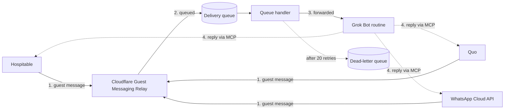

# Technical reference

This is the detailed reference for guest-messaging-relay. For setup, see the [README](../README.md) (people) or [AGENTS.md](../AGENTS.md) (AI agents).

The relay is a receive-only Cloudflare Worker. Hospitable, Quo, and WhatsApp guest messages are normalized and POSTed to a Grok Bot routine webhook. The Worker never calls a send-message API. It does not map lines to properties; the responder bot does that.

Deploying is done by Cloudflare, either with the Deploy to Cloudflare button or from your own computer (section 3). GitHub Actions ([`.github/workflows/test.yml`](../.github/workflows/test.yml)) only runs the typecheck and tests.

## 1. Request flow



Every exchange starts with step 1, a guest message arriving from a channel. Replies (step 4, dotted) do not pass through the relay. The bot sends them through its own MCP connections to each service.

1. A channel POSTs to `/hook/<RELAY_PATH_TOKEN>/...`.
2. The Worker checks the path token, and the channel's signature when that channel is configured.
3. It checks the dedupe store (KV). A message id already forwarded in the last 24 hours is answered with **200** and not queued again.
4. Each guest message becomes one job on the `DELIVERY` queue. Only after the queue accepts the job does the Worker answer **200**. If the queue rejects it, the Worker answers **500** and the channel retries.
5. The queue handler POSTs the job to `RESPONDER_WEBHOOK_URL` with `Authorization` set to `RESPONDER_AUTH_HEADER`.
6. After the bot returns 2xx, the dedupe key is stored in KV for 24 hours.

Reviews and reservation creates/changes from Hospitable are forwarded too, in Hospitable's own shape, not the normalized message shape.

Logs are one JSON status line per decision: `relay`, `source`, `outcome`, and ids. They do not include message text, names, or full phone numbers.

### Setup page and status check

- **`GET /`** serves a static setup page ([src/setup-page.ts](../src/setup-page.ts)). It contains no secrets and is served even before the required secrets are set. Headers: a strict Content-Security-Policy (`connect-src 'self'`, `frame-ancestors 'none'`), `no-store`, and `no-referrer`.
- **The page** asks for the relay password and calls `GET /hook/<password>/status` on the same relay. It never stores the password.
- **`GET /hook/<token>/status`** answers `{"relay":"ok","channels":{"hospitable":true,"quo":bool,"whatsapp":bool}}`, which says only whether each channel's secrets are set. A wrong token gets **404**, a non-GET request gets **405**, and incomplete settings get **500**.

## 2. Delivery, retries, and limits

- **Retries.** A failed POST (non-2xx, network error, or no answer within 30 seconds) is retried by Cloudflare Queues. The delay is 60 seconds, then doubles each time up to one hour (`retryDelaySeconds` in `src/index.ts`). After `max_retries` (20) the job moves to the dead-letter queue `guest-messaging-relay-delivery-dlq`. The 20 retries span about 15 hours.
- **Keep the numbers in sync.** `max_retries` in `wrangler.jsonc` must match `MAX_DELIVERY_RETRIES` in `src/index.ts`.
- **Duplicates.** The queue handler checks the dedupe key again before posting, so two copies of a message queued close together are forwarded once. Queues guarantees at-least-once delivery, so the bot should still ignore a `message_id` it has already handled.
- **Oversized jobs.** Queue messages are capped at 128 KB. A job over 120 KB (in practice, only a very large Hospitable reservation) skips the queue and is POSTed once directly, best effort. The log line is `queue_bypassed_size`.
- **Consumer batching.** `max_batch_size` is 10 and `max_batch_timeout` is 1 second, so a message normally reaches the bot within about a second.

Limits on the Workers Free plan:

| Resource | Free plan | Use per forwarded message |
| --- | --- | --- |
| KV writes | 1,000 / day | 1 (dedupe key). **This is the tightest limit: about 1,000 forwarded items a day.** Past it, forwarding continues but dedupe keys are not stored until the reset at 00:00 UTC. |
| KV reads | 100,000 / day | 2 |
| Queues operations | 10,000 / day | About 3, plus 1 per retry |
| Queue retention | 24 hours, fixed | Jobs older than that are dropped |
| Worker requests | 100,000 / day | 1 webhook request plus queue handler runs |

See [Queues pricing](https://developers.cloudflare.com/queues/platform/pricing/) and [KV pricing](https://developers.cloudflare.com/kv/platform/pricing/).

## 3. Deploying

### Deploy to Cloudflare button

The README's button:
- Copies this repository into the user's GitHub account.
- Creates the KV namespace and the delivery queue, and writes the new KV id into the copy's `wrangler.jsonc`. Cloudflare creates the dead-letter queue on the first deploy.
- Asks for the secrets left uncommented in [`.dev.vars.example`](../.dev.vars.example), with help text from `cloudflare.bindings` in `package.json`.
- Sets up Workers Builds, so every push to the copy's main branch redeploys it.

The button needs default resource names and ids to replace, so `wrangler.jsonc` keeps the author's KV id. A copy gets its own namespace and id. Queue names are fixed. Two relays in one account need different queue names, because a queue can have only one consumer.

The copy starts as a single commit, and it doesn't include `.github/workflows`, so tests don't run on GitHub in a copy. `workers_dev` is on because the setup page and webhook links use the `workers.dev` address. `preview_urls` is off, so test versions don't get their own address.

### Deploy from your own computer

For developers and local AI agents. Run these from a clone of the repository. `wrangler login` opens a browser for the Cloudflare login, so no API token is needed.

```sh
npm ci
npx wrangler login
npx wrangler kv namespace create DEDUPE   # copy the printed id into wrangler.jsonc
npx wrangler queues create guest-messaging-relay-delivery
npx wrangler secret put RELAY_PATH_TOKEN
npx wrangler secret put RESPONDER_WEBHOOK_URL
npx wrangler secret put RESPONDER_AUTH_HEADER
npx wrangler deploy
```

`wrangler secret put` asks for each value with hidden input. On a Worker that doesn't exist yet, it creates the Worker so the secret has somewhere to go. Run `npm test` and `npm run typecheck` before deploying changes.

For local development, copy `.dev.vars.example` to `.dev.vars` and run `npm run dev`. Because `wrangler.jsonc` declares `secrets.required`, `wrangler dev` loads only those three keys from `.dev.vars`. Channel secrets therefore show as not ready on the local setup page.

## 4. Worker secrets

Set secrets in the Cloudflare dashboard (**Workers & Pages → your relay → Settings → Variables and Secrets**, type **Secret**) or with `npx wrangler secret put NAME`. See [Workers secrets](https://developers.cloudflare.com/workers/configuration/secrets/).

- **Required ones.** `wrangler.jsonc` lists the three required secrets under `secrets.required`, so `wrangler deploy` fails until they exist.
- **Redeploys keep secrets.** A redeploy (including Workers Builds) does not delete secrets.
- **Plain-text variables don't survive.** A redeploy *does* remove plain-text variables added in the dashboard, so add `ENFORCE_HOSPITABLE_IP` as type **Secret** too.

| Secret | Required | When it is missing |
| --- | --- | --- |
| `RELAY_PATH_TOKEN` | Yes | Every request is **500**. Also **500** if it is shorter than 32 characters or has anything but letters and digits. |
| `RESPONDER_WEBHOOK_URL` | Yes | Every request is **500**. Also **500** if it is not an `https://` URL. |
| `RESPONDER_AUTH_HEADER` | Yes | Every request is **500**. |
| `QUO_WEBHOOK_SECRET` | For Quo | `POST /hook/<token>/quo` is **503**. |
| `WHATSAPP_VERIFY_TOKEN` | For WhatsApp | Both WhatsApp methods are **503** if either WhatsApp secret is unset. |
| `WHATSAPP_APP_SECRET` | For WhatsApp | Same as the verify token. |
| `HOSPITABLE_WEBHOOK_SECRET` | No | Signature check is skipped. When set, `Signature` must be the hex HMAC-SHA256 of the raw body. |
| `ENFORCE_HOSPITABLE_IP` | No | The Hospitable IP check stays on. Only the exact value `false` turns it off. |

Generate `RELAY_PATH_TOKEN` with `openssl rand -hex 32` or a password manager (letters and digits only, 32 or more). It is one URL path segment.

## 5. Responder bot

In Grok Bot, create a routine whose trigger is a webhook. That trigger gives you a webhook URL and an Authorization header value.

- `RESPONDER_WEBHOOK_URL` is that URL.
- `RESPONDER_AUTH_HEADER` is the routine's key (`crsr_...`). A value with no space gets `Bearer ` added (`authorizationValue` in `src/lib.ts`). A full header such as `Bearer crsr_...` is used as is.
- Both values are in the Grok Bot app (desktop or phone): open the bot, then **Details**, then the routine that runs **When a webhook fires**, then the **Webhook** section at the bottom. **POST to** is the URL and **key** is the key; the **header** row is the same key with `Bearer ` in front.

## 6. Hospitable

Webhook URL:

```text
https://<worker>.<account-subdomain>.workers.dev/hook/<RELAY_PATH_TOKEN>/hospitable
```

`POST /hook/<RELAY_PATH_TOKEN>` is the same handler. See [Webhooks for Reservations, Properties, Messages, and Reviews](https://help.hospitable.com/en/articles/10008203-webhooks-for-reservations-properties-messages-and-reviews). Point it at message, reservation, and review events. Property events are acknowledged and not forwarded.

By default `CF-Connecting-IP` must be in `38.80.170.0/24`, Hospitable's published source range. Set `ENFORCE_HOSPITABLE_IP` to the exact string `false` only if a proxy replaces that header.

Guest messages are forwarded only when `data.sender_type` is `guest` and `data.source` is not `automated`, `AI`, `public_api`, or `hospitable`. `sender_role` is ignored. `review.created`, `reservation.created`, and `reservation.changed` are forwarded on their own, keyed on the webhook event id. Other actions return **200** and are not forwarded.

## 7. Quo

Create a webhook for `message.received` on each line you want. See [Webhooks](https://support.quo.com/core-concepts/integrations/webhooks) and [Validate webhook signatures](https://www.quo.com/docs/2026-03-30/webhooks-signature-validation). Put the signing secret in `QUO_WEBHOOK_SECRET`.

- **Current webhooks** use a `whsec_` secret and the headers `webhook-id`, `webhook-timestamp` (unix seconds), and `webhook-signature` (`v1,<base64>`, space-separated). The signature is HMAC-SHA256 over `id.timestamp.` plus the raw body. The Worker strips one `whsec_` prefix and base64-decodes the rest.
- **Older webhooks** use `openphone-signature: hmac;1;<timestamp>;<base64>` and a bare base64 secret. A 13-digit timestamp is milliseconds.

Either valid scheme is accepted. A timestamp more than 5 minutes off is **401**.

Every `message.received` with `direction` `incoming` is forwarded, from any line. `inbox` is the receiving number in E.164, taken from `to` (a string, or the first E.164 value in an array). Other event types return **200** and are not forwarded.

## 8. WhatsApp

In the Meta app, subscribe to WhatsApp `messages` and set the callback URL:

```text
https://<worker>.<account-subdomain>.workers.dev/hook/<RELAY_PATH_TOKEN>/whatsapp
```

Use the same string for Meta's verify token and `WHATSAPP_VERIFY_TOKEN`. Put the app secret in `WHATSAPP_APP_SECRET`. See [Getting started with webhooks](https://developers.facebook.com/docs/graph-api/webhooks/getting-started/). Both secrets must be on the Worker before you save the callback URL in Meta, or the handshake gets **503**.

- **Handshake.** `GET` with `hub.mode=subscribe` and a matching `hub.verify_token` returns `hub.challenge` as text.
- **Messages.** `POST` requires `X-Hub-Signature-256: sha256=<hex HMAC-SHA256 of the raw body>`.
  - Text messages are forwarded.
  - Other types are forwarded with an empty body plus `media_type` and `media_id`. Captions and button replies are not included.
  - Status receipts are ignored.
  - A message id repeated within one batch is queued once.
  - If any dedupe read fails, the whole batch gets **500** before anything is queued, so Meta redelivers it.

No WhatsApp access token is stored; this Worker only receives.

## 9. Normalized payload

Quo and WhatsApp messages, and the extra fields on a Hospitable guest message, look like this (fake data).

Quo. `inbox` is the receiving line. There is no `property` field.

```json
{
  "source": "quo",
  "event_type": "message",
  "inbox": "+15555550100",
  "sender": { "phone": "+15555550103" },
  "message_id": "AC-example",
  "body": "Hello",
  "created_at": "2024-01-01T00:00:00.000Z"
}
```

Hospitable keeps `event_type` as `message.created` plus its slim fields (`message_id`, `property_id`, `property_name`, and the rest), so an existing routine still sees them. `property` is included only when Hospitable sent a property name. `inbox` is the string `hospitable`.

```json
{
  "source": "hospitable",
  "event_type": "message.created",
  "inbox": "hospitable",
  "sender_type": "guest",
  "message_id": "msg-example",
  "property_id": "prop-example",
  "property_name": "Example Cabin",
  "property": "Example Cabin",
  "body": "Hello",
  "sender": { "first_name": "Ada" }
}
```

`body` is at most 4000 characters. `truncated` is present and `true` only when the text was cut. `sender.phone`, `sender.id`, and `sender.first_name` are omitted when they do not apply. WhatsApp `inbox` is `metadata.phone_number_id`. WhatsApp and Quo omit `property`.

Reservation and review events forward Hospitable's own object (`reservation` or `review`), including the guest's contact details. Reservation `properties` are trimmed to id, names, timezone, check-in/out, capacity, and house rules.

## 10. Testing and troubleshooting

```sh
npm ci
npm test
npm run typecheck
```

- **Dry run.** `npx wrangler deploy --dry-run --outdir dist` builds a bundle and does not deploy.
- **Queue in tests.** The tests replace the `DELIVERY` queue with an in-memory stand-in (`test/queue.ts`). `settle(ctx)` waits for the request, then runs the queue handler over what it queued. `drainQueue()` runs one more delivery round for retried jobs.
- **Regenerate types** with `npm run types` after changing bindings in `wrangler.jsonc`.
- **Entry module exports.** `src/index.ts` exports only the default handler. Cloudflare's runtime rejects a main module that exports constants or plain functions, and tests don't catch it, so shared values go in `src/lib.ts`. `npm run dev` does catch it.

| Situation | Status |
| --- | --- |
| Path or token does not match | **404** |
| Hospitable path, method is not POST | **405** |
| Required secret missing or invalid (short relay password, non-https bot URL) | **500** |
| Dedupe store unreadable (the sender retries) | **500** |
| Queue rejected the job (the sender retries) | **500** |
| Quo signing secret unset | **503** |
| Either WhatsApp secret unset | **503** |
| Bad or stale signature | **401** |
| Event ignored, duplicate, or not a guest message | **200**, nothing forwarded |
| Accepted | **200** once queued; the bot POST happens in the queue handler |

Each log line is JSON with `relay` set to `guest-messaging-relay`.

- **`outcome`** is the decision:
  - Request side: `ignored`, `duplicate`, `misconfigured`, `dormant`, `rejected_path`, `rejected_signature`, `stale_timestamp`, `queue_failed`, `queue_bypassed_size`.
  - Queue handler: `forwarded`, `forward_failed`, `duplicate`, `dedupe_write_failed`.
- **`attempt`** is the queue delivery attempt, starting at 1.
- **`routine_status`** is the bot's HTTP status, or `0` for a network error or timeout.

The line does not include the message, the guest's name, or a full phone number.

### Temporary payload-shape diagnostics

While `SHAPE_DIAGNOSTICS` is `true` in [src/shape-diagnostics.ts](../src/shape-diagnostics.ts), every verified Quo or WhatsApp POST adds one extra JSON line: `diag` is `payload_shape`, plus `source`, `outcome`, `reason`, and `shape`. `shape` is field names and JSON types. A few enum keys (`type`, `direction`, `status`, `apiVersion`, and the other names in that file) include the value only when it is a short token. Message text, names, phone numbers, emails, ids, URLs, headers, and secrets are not logged. Rejected requests, Hospitable, and the WhatsApp handshake do not emit the line. `outcome` is null when the POST was accepted for delivery; the queue line still reports `forwarded` or `forward_failed`. Delete the module and its call sites after one or two live messages per channel.
